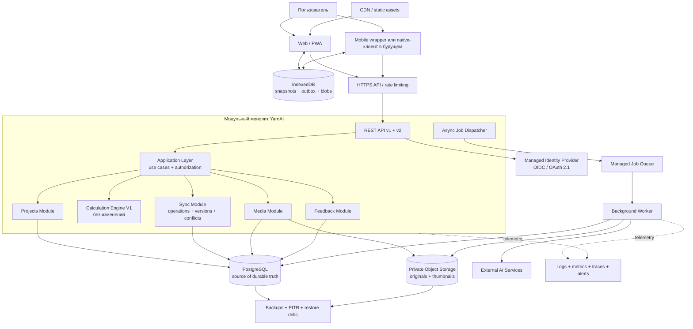
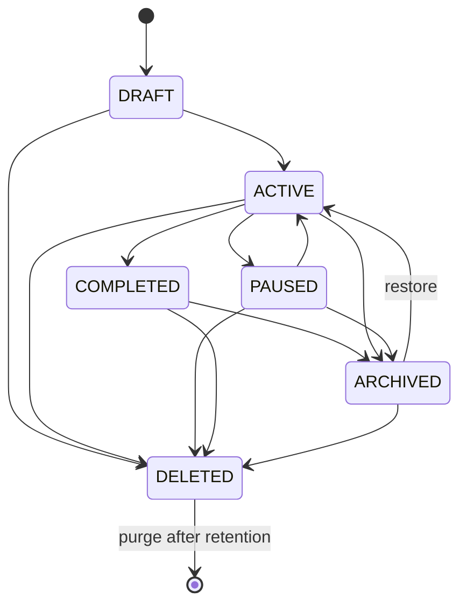
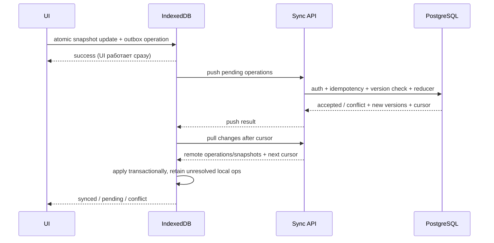
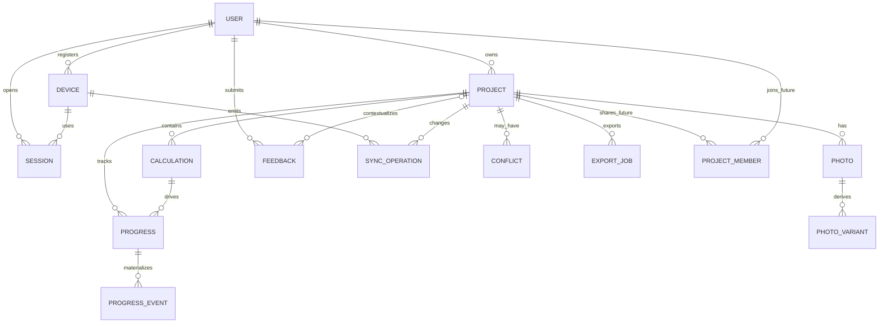
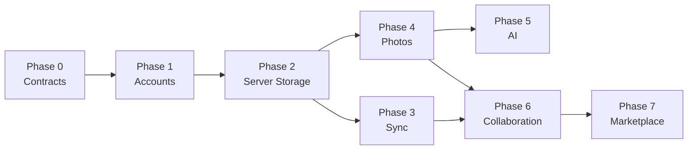

# SYNC_ARCHITECTURE_V1 — архитектура YarnAI V2

Статус документа: `PROPOSED`  
Тип работы: `ARCHITECTURE_ONLY`  
Область: переход от локального состояния YarnAI V1 к облачному продукту с аккаунтами, несколькими устройствами и offline-first синхронизацией  
Дата: 2026-07-30

## Краткое решение

Рекомендуемая YarnAI V2 — это эволюция существующего приложения в **модульный монолит** с сохранённым Calculation Engine, версионированным REST API, PostgreSQL, приватным S3-совместимым объектным хранилищем и offline-first клиентским репозиторием на IndexedDB.

Клиент немедленно записывает пользовательские действия локально, помещает операции в outbox и синхронизирует их с сервером при появлении сети. Сервер является долговременным источником истины между устройствами, но не блокирует локальную работу. Безопасные изменения сливаются автоматически; неоднозначные изменения прогресса создают явный Conflict, не теряя ни одной версии.

V2 добавляется вокруг V1 через совместимые адаптеры. Не переписываются Calculation Engine, формулы, алгоритм fingerprint, Smart Start, Step Assistant и существующие тесты. Текущий `POST /api/v1/calculate` сохраняется как совместимый контракт на период миграции.

---

## 1. Текущее состояние

### 1.1. Что уже реализовано

YarnAI V1 состоит из:

- Python 3.12-приложения на Starlette/Uvicorn;
- статического web-интерфейса без клиентского framework;
- расчётного HTTP-контракта `POST /api/v1/calculate`;
- отдельного пакета `yarnai_calculation` с моделями, валидацией, инвариантами, диагностикой и детерминированным Calculation Engine;
- сценария Smart Start из шести шагов;
- Step Assistant с прогрессом по рядам и петлям;
- локального списка тестовых проектов/расчётов;
- локальной формы обратной связи;
- unit-, property-, HTTP- и UI-интеграционных тестов;
- health endpoint и минимального production deployment-контура.

Состояние пользователя хранится в `localStorage` текущего browser origin:

| Данные V1 | Ключ |
|---|---|
| Текущий расчёт Smart Start | `yarnai.smartStart.calculation.v1` |
| Расчёт по fingerprint | `yarnai.smartStart.calculation.v1.{fingerprint}` |
| Прогресс Smart Start | `yarnai.smartStart.progress.v1.{fingerprint}` |
| Прогресс Step Assistant | `yarnai.stepAssistant.progress.v1.{fingerprint}` |

Расчёт Smart Start уже имеет `version`, `fingerprint`, `createdAt`, `workingCount`, данные ширины, плотности, материалов и контекста. Прогресс также версионирован и содержит `lastUpdated`. Это хорошая исходная точка для безопасной миграции.

### 1.2. Ограничения

- Нет аккаунта и устойчивой идентичности пользователя.
- Данные привязаны к одному browser profile и одному origin.
- Нет общей истории между телефоном, ноутбуком и планшетом.
- Очистка browser data означает потерю пользовательского состояния.
- Сервер не хранит проекты, прогресс, фотографии и feedback.
- `localStorage` синхронный, ограничен по объёму и не предоставляет транзакций, индексов и надёжного outbox.
- В V1 нет модели конкурентных изменений и конфликтов.
- Нет резервного копирования пользовательских данных и серверного восстановления.
- Новые расчёты выполняются серверным Python Calculation Engine, поэтому без доступного API новый расчёт сделать нельзя.
- Фотографии, AI-анализ, совместная работа и marketplace не реализованы.

### 1.3. Сильные стороны

- Расчётное ядро отделено от HTTP и UI.
- Математика детерминирована и покрыта тестами.
- Fingerprint даёт стабильную проверку целостности расчётного snapshot.
- Local state имеет явные версии и валидацию.
- Smart Start и Step Assistant являются самостоятельными state-модулями.
- Приложение небольшое, поэтому его можно эволюционировать через адаптеры без «большого взрыва».
- Текущий stateless HTTP-процесс естественно масштабируется горизонтально после вынесения состояния в PostgreSQL.

---

## 2. Целевая архитектура

### 2.1. Полная схема



Monitoring и backups являются поперечными контурами, а не следующими слоями пользовательского запроса. AI не находится на критическом пути расчёта, открытия проекта или синхронизации.

### 2.2. Назначение слоёв

| Слой | Назначение | Не должен делать |
|---|---|---|
| Web/PWA/Mobile | UI, локальная работа, IndexedDB, outbox, отображение sync/conflict state | Считать сервер доверенным только по client payload; хранить долговечные секреты в JavaScript |
| CDN/static | Быстро и дёшево отдавать версионированные assets | Хранить персональные проекты |
| API gateway | TLS, ограничения размера, rate limits, request ID | Содержать бизнес-логику |
| REST API | Версионированный внешний контракт и валидация транспорта | Дублировать формулы Calculation Engine |
| Application Layer | Use cases, транзакционные границы, tenant authorization, orchestration | Содержать UI-логику |
| Sync Module | Idempotency, aggregate versions, change cursor, conflict records, snapshots | Выбирать победителя в неоднозначном конфликте молча |
| Calculation Engine | Те же математические вычисления, инварианты и диагностика V1 | Знать об аккаунтах, БД, фотографиях или sync |
| Projects Module | Lifecycle проекта, расчёты, экспорт, копирование | Хранить binary-файлы в PostgreSQL |
| Media Module | Метаданные, signed upload/download, lifecycle объектов | Делать bucket публичным |
| PostgreSQL | Пользователи, проекты, операции, snapshots, conflicts, metadata | Хранить оригиналы фотографий как BLOB |
| Object Storage | Оригиналы, производные изображения и export archives | Быть источником прав доступа без проверки API |
| Queue/Worker | Миниатюры, антивирусная проверка, EXIF policy, exports, AI jobs | Блокировать основной sync request |
| AI Services | Опциональный анализ изображения с явным consent | Изменять расчёт или прогресс без подтверждённого domain use case |
| Observability | Технические метрики, аудит, traces, alerting | Записывать фото, access tokens и полный чувствительный payload |
| Backup/Recovery | PITR БД, versioning объектов, проверяемое восстановление | Подменять пользовательскую корзину и политику удаления |

### 2.3. Границы deployment

На этапах до 10 000 пользователей API, Application Layer, Projects, Sync, Media и Feedback остаются модулями одного deployable Python-приложения. Отдельным процессом является только background worker. Это решение D1.

Логические границы модулей вводятся сейчас, но физическое разделение на микросервисы допускается только после измеренного bottleneck или независимой организационной потребности.

---

## 3. Аккаунты

### 3.1. Модель идентичности

Рекомендуется managed Identity Provider с OIDC/OAuth 2.1 (D6). YarnAI хранит собственный `User`, связанный с неизменяемым `auth_subject`; password hash, email verification и reset tokens остаются у identity provider.

Основной вход:

1. Email + password с обязательным подтверждением email.
2. Восстановление через одноразовую короткоживущую ссылку.
3. Опционально после проверки спроса — Google/Apple и passkeys.
4. MFA сначала обязательно для администраторов, затем опционально для пользователей.

Email является атрибутом входа, но не primary key и не идентификатором владельца данных.

### 3.2. Регистрация

1. Пользователь может начать в гостевом режиме без регистрации.
2. При регистрации identity provider подтверждает email.
3. YarnAI создаёт `User` идемпотентно по `auth_subject`.
4. Клиент предлагает перенести локальные гостевые проекты.
5. Импорт выполняется отдельным idempotent migration batch.
6. До подтверждения серверной копии локальные данные не удаляются.

Слияние существующего аккаунта и гостевых данных всегда требует явного выбора пользователя. Автоматическое удаление или замещение серверных проектов запрещено.

### 3.3. Вход и сессия

- Web: short-lived access token передаётся в `Secure`, `HttpOnly`, `SameSite=Lax/Strict` cookie; refresh credential также ротируется и хранится только в `HttpOnly` cookie.
- Native/mobile: Authorization Code + PKCE; refresh credential хранится в OS secure storage.
- Access token живёт 5–15 минут.
- Refresh credential ротируется при каждом использовании; повторное использование старого токена отзывает token family.
- YarnAI проверяет issuer, audience, signature, expiry и subject.
- Для cookie-auth mutating endpoints дополнительно проверяются CSRF token/origin.

JWT не используется как долгоживущая сессия в `localStorage`. Допустим короткий signed JWT как access token; долгоживущая серверная сессия/refresh credential остаётся отзывной. Это гибридное решение даёт совместимость web/mobile без неотзываемых токенов.

### 3.4. Восстановление

- `forgot-password` всегда возвращает нейтральный ответ, не раскрывая наличие email.
- Reset link одноразовый, короткоживущий и инвалидируется после применения.
- После смены пароля пользователь может отозвать все остальные сессии.
- Смена email требует подтверждения старого или усиленной re-authentication.
- Support не получает возможность видеть пароль или выдавать новый пароль вручную.

### 3.5. Гостевой режим

Гость получает локальный `guest_id` и `device_id`. Его данные доступны полностью локально, но:

- не синхронизируются между устройствами;
- не имеют серверного backup;
- теряются при очистке browser data;
- не дают доступ к AI и облачному upload до явного consent/регистрации;
- могут быть экспортированы в JSON/ZIP;
- могут быть «присвоены» аккаунтом через migration batch (D9).

### 3.6. Несколько устройств и смена устройства

Каждая установка приложения получает client-generated `device_id`. Это метка синхронизации, а не authentication factor.

После входа на новом устройстве:

1. создаётся/обновляется `Device`;
2. выполняется bootstrap активных проектов;
3. клиент получает server cursor и snapshots;
4. изображения подгружаются лениво;
5. дальнейшие изменения идут через обычный push/pull.

В разделе безопасности пользователь видит имя устройства, примерное время последней активности и список сессий. Потерянное устройство можно отозвать. Отзыв блокирует будущую синхронизацию с него; при следующем соединении оно обязано удалить account-scoped cache. Для общего устройства logout по умолчанию очищает локальный cache аккаунта.

---

## 4. Проекты

### 4.1. Структура проекта

`Project` — пользовательский контейнер работы, а не сам расчёт и не изображение изделия.

```text
Project
├── metadata: title, notes, status, timestamps
├── calculations: immutable calculation snapshots
├── active_calculation_id
├── progress
│   ├── SMART_START snapshot + operations
│   └── STEP_ASSISTANT snapshot + operations
├── photos: metadata + object references
├── sync metadata: version, updated_at
└── optional future members/roles
```

Fingerprint остаётся идентификатором содержания расчёта, но не становится глобальным primary key проекта. Разные пользователи и разные проекты могут законно иметь одинаковый fingerprint.

### 4.2. Lifecycle



- `DRAFT`: создан, но вязание не начато.
- `ACTIVE`: текущая работа.
- `PAUSED`: временно остановлен.
- `COMPLETED`: изделие завершено.
- `ARCHIVED`: скрыт из основного списка, доступен для просмотра/экспорта.
- `DELETED`: tombstone в корзине до окончательного удаления.

### 4.3. Операции

| Операция | Семантика |
|---|---|
| Создание | Client-generated project ID; возможно offline; сервер принимает идемпотентно |
| Архивирование | Меняет lifecycle status, не удаляет расчёты, progress и photos |
| Восстановление | Возвращает архивный проект в `ACTIVE` или исходный допустимый status |
| Копирование | Новый project ID; копируются metadata и выбранный calculation snapshot; progress по умолчанию начинается заново; photos копируются только по явному выбору |
| Удаление | Сразу скрывается, создаёт sync tombstone; восстановление возможно 30 дней |
| Окончательное удаление | После grace period удаляются связанные данные и object references; physical objects очищаются lifecycle job |
| Экспорт | Версионированный JSON manifest; при выборе photos — ZIP, создаваемый background job |

Экспорт содержит schema version, project data, calculation input/result, исходный fingerprint, progress history, media manifest и checksums. Экспорт не содержит access/refresh tokens и внутренние server credentials.

---

## 5. Синхронизация

### 5.1. Модель

Рекомендуется гибрид **operation log + materialized snapshots** (D4):

- UI читает быстрый локальный snapshot.
- Каждое изменение сначала транзакционно меняет snapshot в IndexedDB и добавляет operation в outbox.
- Сервер дедуплицирует operation по `operation_id`.
- Принятые операции изменяют server snapshot и увеличивают `aggregate_version`.
- Server change feed выдаёт устройствам изменения по opaque cursor.
- Старые операции после retention/acknowledgement могут compact-иться, snapshots остаются.

Операция содержит минимум:

```json
{
  "operation_id": "client-generated UUIDv7/ULID",
  "device_id": "device UUID",
  "device_sequence": 184,
  "project_id": "project UUID",
  "aggregate_type": "progress",
  "aggregate_id": "progress UUID",
  "base_version": 27,
  "kind": "ROW_COMPLETED",
  "payload": {"row": 18, "calculation_fingerprint": "…", "epoch": 1},
  "occurred_at": "2026-07-30T12:00:00.000Z",
  "schema_version": 1
}
```

Client time используется для отображения, но не определяет порядок истины. Порядок сервера задают транзакция, `aggregate_version` и change cursor.

### 5.2. Протокол одного sync cycle



`WebSocket` или Server-Sent Events может сообщать «появились изменения», но корректность не зависит от постоянного соединения. После notification клиент всё равно делает pull (D14).

### 5.3. Сценарий: телефон → ноутбук → планшет → телефон

#### Телефон

1. Пользователь открывает уже закэшированный проект.
2. Переходит на следующий ряд.
3. Телефон в одной IndexedDB transaction обновляет локальный progress snapshot и создаёт outbox operation.
4. UI сразу показывает новый ряд и статус `Сохранено на устройстве`.
5. При наличии сети телефон делает push.
6. Сервер проверяет owner, fingerprint/epoch и `base_version`, фиксирует operation, увеличивает version и возвращает cursor.
7. Телефон помечает operation подтверждённой и показывает `Синхронизировано`.

#### Ноутбук

1. Пользователь входит в тот же аккаунт.
2. Ноутбук делает bootstrap/pull с последнего cursor.
3. Получает project snapshot и принятые операции телефона.
4. Локальный reducer восстанавливает тот же ряд.
5. Изменение на ноутбуке сначала сохраняется локально, затем push-ится по той же схеме.

#### Планшет

1. Планшет может иметь старый cache.
2. Перед показом статуса он сразу отображает cache с индикатором `Обновляем`.
3. Pull получает изменения телефона и ноутбука.
4. Если локальный outbox пуст, snapshot заменяется/обновляется без конфликта.
5. Если есть локальные изменения, они rebase-ятся на server version; безопасные операции применяются, неоднозначные образуют Conflict.

#### Возврат на телефон

1. Push оставшегося outbox выполняется первым, чтобы локальные изменения не потерялись.
2. Затем телефон делает pull после своего cursor.
3. Получает изменения ноутбука и планшета.
4. Reducer строит актуальный progress.
5. При конфликте пользователь видит не общий «sync error», а конкретные варианты и может выбрать/объединить их.

### 5.4. Гарантии

- **At-least-once delivery**, но exactly-once effect через уникальный `operation_id`.
- Изменение никогда не считается потерянным из-за сетевого timeout: неизвестный результат отправляется повторно с тем же ID.
- Push и pull пагинируются.
- Удаление распространяется как tombstone.
- Server cursor opaque; клиент не вычисляет его сам.
- При истёкшем cursor сервер отвечает `CURSOR_EXPIRED`, отдаёт свежий snapshot, а локальный outbox rebase-ится поверх него.
- Schema version присутствует в snapshot и operation.
- Fingerprint проверяет calculation payload, но не заменяет operation ID, project ID или concurrency version.

---

## 6. Offline-first

### 6.1. Полностью работает без интернета

После хотя бы одного успешного открытия/кэширования:

- запуск PWA shell;
- просмотр локально доступных проектов;
- открытие ранее сохранённого calculation result;
- Smart Start;
- Step Assistant;
- переходы по шагам, рядам и петлям;
- локальное создание проекта/draft;
- редактирование title/notes;
- архивирование/удаление с локальным tombstone;
- создание feedback draft;
- добавление фотографии в локальную upload queue в пределах квоты устройства;
- экспорт локально доступного проекта без ещё не загруженных remote originals.

Все действия получают status `Сохранено на устройстве`, `Ожидает синхронизации` или `Конфликт`.

### 6.2. Требует подключения

- регистрация, первичный вход и password recovery;
- первая загрузка проекта на новом устройстве;
- новый расчёт через существующий server-side Python Calculation Engine;
- загрузка/скачивание отсутствующих локально original photos;
- AI-анализ;
- отправка feedback;
- окончательное серверное удаление;
- проверка отзыва устройства/сессии;
- серверный full export с remote originals.

Перенос Calculation Engine в browser не входит в базовую V2: это означало бы отдельный packaging/runtime project и повышало бы риск расхождения с нормативным Python-ядром. Если продукту понадобится полностью offline новый расчёт, допустим отдельный spike с запуском того же Python package через совместимый runtime; формулы и normative tests при этом остаются общими.

### 6.3. Последующая синхронизация

1. Network status служит подсказкой, но реальная доступность определяется попыткой sync.
2. Outbox отправляется пакетами с exponential backoff + jitter.
3. Auth refresh выполняется до push; при необходимости re-login pending operations сохраняются.
4. После push выполняется pull до актуального cursor.
5. Результат применяется одной IndexedDB transaction.
6. Подтверждённые outbox entries compact-ятся после безопасного checkpoint.
7. Ошибка одного project/operation не блокирует остальные.

### 6.4. Отображение состояния

Минимальная модель UI-состояний для будущей реализации:

- `Локально` — гостевые данные без cloud;
- `Сохранено на устройстве` — local transaction завершена;
- `Синхронизация…`;
- `Синхронизировано · время`;
- `Нет сети · N изменений ожидают`;
- `Требуется вход · изменения сохранены`;
- `Конфликт · сравнить версии`;
- `Ошибка синхронизации · повторить`.

Нельзя показывать `Синхронизировано` до server acknowledgement.

---

## 7. Конфликты

### 7.1. Классы конфликтов

Рекомендуется domain-aware optimistic concurrency, а не глобальный last-write-wins (D5).

| Класс | Пример | Стратегия |
|---|---|---|
| Независимые изменения | Телефон меняет title, ноутбук отмечает ряд | Автоматически объединить |
| Append-only | Разные photos/feedback drafts | Сохранить оба |
| Идемпотентное событие | Оба устройства повторно подтверждают один operation ID | Применить один раз |
| Безопасный progress merge | Устройства отмечают разные завершённые ряды одной epoch, а объединение сохраняет непрерывность | Union событий и пересчёт snapshot |
| Неоднозначный progress | Оба меняют текущую позицию от одной base version, физически невозможно понять, были ли действия дубликатами | Создать Conflict |
| Destructive intent | Reset/rewind против advance | Никогда не auto-merge; явный выбор |
| Calculation divergence | Progress относится к разным fingerprint/active calculation | Разделить ветки или выбрать active calculation явно |
| Delete vs edit | Одно устройство удалило, другое редактировало | Tombstone + recoverable conflict, без тихой потери edit |

### 7.2. Телефон изменил ряд, ноутбук тоже изменил ряд

Если оба online, первый accepted operation меняет aggregate version. Второй приходит с устаревшим `base_version`.

- Если операции представляют независимые `ROW_COMPLETED` и их union сохраняет инвариант непрерывно завершённых рядов в одной calculation/epoch, сервер объединяет их.
- Если оба меняют `currentRow/currentStitch` как абсолютный snapshot, server не складывает значения и не выбирает большее автоматически.
- Если одно действие является rewind/reset, создаётся Conflict.
- В Conflict сохраняются ancestor/base, phone version и laptop version.

### 7.3. Оба устройства offline

Оба продолжают работать локально. После восстановления сети порядок подключения не должен определять потерю данных:

1. Первый device push создаёт новые server versions.
2. Второй device push сравнивается с общим ancestor.
3. Безопасные операции rebase-ятся.
4. Неоднозначные варианты сохраняются в `Conflict`.
5. Пользователь выбирает:
   - «Оставить прогресс телефона»;
   - «Оставить прогресс ноутбука»;
   - «Указать текущий ряд и петлю вручную».
6. Resolution является новой операцией с ссылкой на оба варианта.

### 7.4. Одно устройство устарело

- Обычное отставание закрывается pull.
- Если cursor уже compacted, сервер отдаёт актуальный snapshot.
- Pending local operations не удаляются; они rebase-ятся.
- Если schema version более не поддерживается, клиент обязан обновиться до push, но предлагает локальный export.
- Если device/session отозван, push запрещается; локальные данные не присоединяются к другому аккаунту автоматически.

### 7.5. Рекомендуемая стратегия progress

1. Хранить `calculation_fingerprint` и `epoch` в каждом progress event.
2. Моделировать `ROW_COMPLETED` как add-event, а не только абсолютное число.
3. Вычислять current progress из непрерывной последовательности подтверждённых rows.
4. Считать изменения внутри незавершённого ряда потенциально неоднозначными при concurrent base version.
5. Моделировать `RESET`/`REWIND` как явную новую epoch или compensating event.
6. Никогда не применять clock-based last-write-wins к progress.
7. Показывать «активно на другом устройстве» как предупреждение, но не вводить жёсткий lock: offline-клиент всё равно не сможет его соблюдать.

---

## 8. База данных

### 8.1. Рекомендуемая СУБД

Managed PostgreSQL — основной transactional store (D2). На этом масштабе он покрывает relation data, JSONB snapshots, constraints, row-level authorization defense-in-depth, transactions, indexes, backups и PITR. Отдельные NoSQL/event-store системы не нужны.

### 8.2. Сущности

| Сущность | Основные поля | Назначение |
|---|---|---|
| `User` | `id`, `auth_subject`, `email_normalized`, `status`, `locale`, timestamps, `deleted_at` | Профиль YarnAI и tenant owner |
| `Project` | `id`, `owner_user_id`, `title`, `notes`, `status`, `active_calculation_id`, `schema_version`, `version`, timestamps, `deleted_at` | Aggregate проекта |
| `Calculation` | `id`, `project_id`, `fingerprint`, `engine_version`, `input_json`, `result_json`, `created_by_device_id`, `supersedes_id`, `created_at` | Immutable результат существующего Engine |
| `Progress` | `id`, `project_id`, `calculation_id`, `kind`, `epoch`, `snapshot_json`, `version`, `updated_by_device_id`, `updated_at` | Materialized state Smart Start/Step Assistant |
| `ProgressEvent` | `id`, `progress_id`, `operation_id`, `kind`, `payload_json`, `base_version`, `applied_version`, `device_id`, timestamps | Domain history для merge/audit |
| `Photo` | `id`, `project_id`, `owner_user_id`, `object_key`, `sha256`, `mime_type`, `byte_size`, dimensions, `status`, timestamps, `deleted_at`, `purge_after` | Metadata приватного media object |
| `PhotoVariant` | `id`, `photo_id`, `kind`, `object_key`, dimensions, size, status | Thumbnail/preview без дублирования Photo |
| `Feedback` | `id`, nullable `user_id`, nullable `project_id`, nullable `calculation_id`, category, message, diagnostics JSON, consent flags, status, timestamps | Обратная связь |
| `Device` | `id`, `user_id`, `installation_id_hash`, display name, platform, app version, `last_seen_at`, `revoked_at` | Видимость и отзыв устройств |
| `Session` | `id`, `user_id`, `device_id`, provider session/token-family reference, `created_at`, `expires_at`, `revoked_at`, last-used metadata | Отзывная YarnAI-сессия без raw token |
| `SyncOperation` | `operation_id`, `user_id`, `device_id`, `device_sequence`, aggregate refs, `base_version`, kind, payload, status, `server_sequence`, timestamps | Idempotency и change feed |
| `Conflict` | `id`, aggregate refs, `base_snapshot`, `left_variant`, `right_variant`, type, status, resolution operation, timestamps | Неоднозначные concurrent edits |
| `ExportJob` | `id`, `project_id`, requester, status, object key, expiry, timestamps | Асинхронный ZIP export |
| `ProjectMember` | `project_id`, `user_id`, role, timestamps | Зарезервирован для collaboration phase, не активируется заранее |

`Sessions` может частично принадлежать managed identity provider. Локальная таблица хранит только необходимую связь с device, отзыв и audit metadata, но не raw refresh token.

### 8.3. Связи



### 8.4. Инварианты и индексы

- `User.auth_subject` unique.
- `Calculation` immutable после создания.
- `UNIQUE(project_id, fingerprint)` допускает одинаковый fingerprint в других проектах.
- Один active `Progress` на `(project_id, calculation_id, kind, epoch)`.
- `SyncOperation.operation_id` globally unique; `(device_id, device_sequence)` unique.
- `Project.version` и `Progress.version` монотонны.
- Все tenant-owned таблицы индексируются по owner/project и `updated_at`.
- `Photo.object_key` opaque и unique; email/filename пользователя в key не помещаются.
- Soft-deleted project остаётся доступным sync feed до истечения retention.
- Foreign keys и DB constraints защищают инварианты дополнительно к application validation.

---

## 9. Хранение файлов

### 9.1. Размещение

Используется приватное S3-совместимое object storage (D7):

- `originals` — исходные photos и изображения изделий;
- `derivatives` — thumbnails/previews/AI-safe normalized copies;
- `exports` — короткоживущие ZIP-файлы;
- `quarantine` — незавершённые или ещё не проверенные uploads.

Физически это могут быть buckets или логические prefixes с отдельными lifecycle policies. Object key:

```text
{environment}/{tenant_id}/{project_id}/{photo_id}/{variant}
```

Оригинальное имя файла хранится только как очищенное metadata при реальной продуктовой необходимости.

### 9.2. Upload

1. Клиент запрашивает upload intent.
2. API проверяет owner, quota, MIME allowlist и ожидаемый размер.
3. API выдаёт короткоживущий signed upload URL.
4. Клиент загружает напрямую в quarantine.
5. Клиент подтверждает upload с checksum.
6. Worker проверяет фактический MIME, размер, checksum и выполняет security scan.
7. Только после этого Photo получает status `READY`.

### 9.3. Миниатюры и оригиналы

- Original сохраняется без необратимого уменьшения.
- Thumbnail и preview создаются background worker.
- Производные изображения получают sanitized metadata; GPS EXIF удаляется.
- Решение о сохранении полного EXIF original фиксируется privacy policy; по умолчанию чувствительные location metadata удаляются и из original ingest copy.
- AI получает отдельную normalized copy или signed read URL минимального срока, только после consent.
- UI загружает thumbnail первым, original — по запросу.

### 9.4. Доступ

- Buckets никогда не публичны.
- Download выполняется через API authorization и signed URL на 5–15 минут.
- Signed URL не логируется целиком.
- CDN, если используется, применяет signed cookies/URLs и не превращает приватный object в публичный.
- Guessable project IDs недостаточно для доступа: owner/member проверяется на каждый intent.

### 9.5. Удаление

- Пользовательское удаление создаёт DB tombstone и `purge_after = deleted_at + 30 days`.
- В течение 30 дней project/photo можно восстановить.
- После срока worker удаляет original и variants, затем оставляет минимальный audit tombstone без content.
- Незавершённые uploads удаляются через 24 часа.
- Export archives удаляются через 24–72 часа.
- Object versioning защищает от операционной ошибки, но старые versions автоматически expire после установленного recovery window.
- Backup retention не используется для обычного восстановления уже окончательно удалённых пользователем данных.

---

## 10. API

### 10.1. Общие правила контракта

- Prefix новых контрактов: `/api/v2`.
- Существующий `/api/v1/calculate` сохраняется без изменения на миграционный период.
- JSON использует ISO 8601 UTC timestamps и opaque string IDs.
- Mutations принимают `Idempotency-Key`.
- Aggregate endpoints возвращают `ETag`/`version`; точечные mutations принимают `If-Match`.
- Ошибка имеет стабильные `code`, `message`, `request_id`, optional `details`.
- Pagination cursor-based.
- Успешный retry с тем же idempotency key возвращает тот же logical result.
- Auth endpoints ниже являются логическим YarnAI contract; managed provider может реализовать redirect/hosted flow.

Пример ошибки:

```json
{
  "error": {
    "code": "VERSION_CONFLICT",
    "message": "Project changed on another device",
    "request_id": "req_…",
    "details": {"current_version": 28, "conflict_id": "con_…"}
  }
}
```

### 10.2. Accounts и sessions

| Метод | Endpoint | Назначение |
|---|---|---|
| `POST` | `/api/v2/auth/register` | Начать регистрацию/redirect к provider |
| `POST` | `/api/v2/auth/login` | Начать вход/обменять authorization code |
| `POST` | `/api/v2/auth/refresh` | Ротация refresh credential |
| `POST` | `/api/v2/auth/logout` | Отозвать текущую session |
| `POST` | `/api/v2/auth/forgot-password` | Нейтрально инициировать recovery |
| `POST` | `/api/v2/auth/reset-password` | Завершить provider recovery |
| `GET` | `/api/v2/me` | Текущий YarnAI User и capabilities |
| `GET` | `/api/v2/devices` | Устройства и sessions |
| `PATCH` | `/api/v2/devices/{deviceId}` | Изменить display name |
| `DELETE` | `/api/v2/devices/{deviceId}` | Отозвать устройство и его sessions |
| `DELETE` | `/api/v2/sessions/{sessionId}` | Отозвать отдельную session |

### 10.3. Projects

| Метод | Endpoint | Назначение |
|---|---|---|
| `GET` | `/api/v2/projects?status=&cursor=&limit=` | Список проектов |
| `POST` | `/api/v2/projects` | Создать идемпотентно, в том числе с client-generated ID |
| `GET` | `/api/v2/projects/{projectId}` | Project snapshot |
| `PATCH` | `/api/v2/projects/{projectId}` | Изменить metadata/status с `If-Match` |
| `POST` | `/api/v2/projects/{projectId}/archive` | Архивировать |
| `POST` | `/api/v2/projects/{projectId}/restore` | Восстановить из архива/корзины |
| `POST` | `/api/v2/projects/{projectId}/duplicate` | Создать копию по явным options |
| `DELETE` | `/api/v2/projects/{projectId}` | Soft delete |
| `POST` | `/api/v2/projects/{projectId}/export` | Начать export job |
| `GET` | `/api/v2/exports/{exportId}` | Status и signed download при готовности |

### 10.4. Calculations и progress

| Метод | Endpoint | Назначение |
|---|---|---|
| `POST` | `/api/v1/calculate` | Неизменный V1 calculation contract |
| `GET` | `/api/v2/projects/{projectId}/calculations` | История immutable calculations |
| `POST` | `/api/v2/projects/{projectId}/calculations` | Вызвать тот же Engine, сохранить input/result/fingerprint |
| `GET` | `/api/v2/projects/{projectId}/calculations/{calculationId}` | Calculation snapshot |
| `POST` | `/api/v2/projects/{projectId}/calculations/{calculationId}/activate` | Явно выбрать active calculation |
| `GET` | `/api/v2/projects/{projectId}/progress` | Materialized progress snapshots |
| `PATCH` | `/api/v2/projects/{projectId}/progress/{progressId}` | Online fallback mutation с version precondition |

Основной offline-first progress write идёт через Sync API, а `PATCH progress` использует тот же Application Layer command/reducer, не отдельную логику.

### 10.5. Sync

| Метод | Endpoint | Назначение |
|---|---|---|
| `POST` | `/api/v2/sync/bootstrap` | Начальный набор snapshots и cursor |
| `POST` | `/api/v2/sync/push` | Идемпотентно принять batch operations |
| `GET` | `/api/v2/sync/pull?cursor=&limit=` | Получить change feed |
| `GET` | `/api/v2/conflicts?status=OPEN` | Список конфликтов |
| `GET` | `/api/v2/conflicts/{conflictId}` | Base и оба варианта |
| `POST` | `/api/v2/conflicts/{conflictId}/resolve` | Записать explicit resolution operation |

Пример push response:

```json
{
  "accepted": [
    {"operation_id": "op_1", "aggregate_version": 28}
  ],
  "conflicts": [
    {"operation_id": "op_2", "conflict_id": "con_1", "code": "PROGRESS_DIVERGED"}
  ],
  "rejected": [],
  "next_cursor": "opaque_cursor"
}
```

HTTP `200` допустим для batch с разными результатами; transport/auth/whole-request failure возвращается соответствующим `4xx/5xx`.

### 10.6. Photos и feedback

| Метод | Endpoint | Назначение |
|---|---|---|
| `POST` | `/api/v2/projects/{projectId}/photos/upload-intents` | Signed upload + ограничения |
| `POST` | `/api/v2/projects/{projectId}/photos/{photoId}/complete` | Проверить checksum и поставить processing job |
| `GET` | `/api/v2/projects/{projectId}/photos` | Media metadata |
| `GET` | `/api/v2/projects/{projectId}/photos/{photoId}/download` | Короткоживущий signed URL |
| `DELETE` | `/api/v2/projects/{projectId}/photos/{photoId}` | Soft delete |
| `POST` | `/api/v2/feedback` | Создать feedback с явными consent flags |
| `POST` | `/api/v2/projects/{projectId}/ai-analysis` | Будущий async AI job, не включается до Phase 5 |
| `GET` | `/api/v2/ai-jobs/{jobId}` | Будущий status/result |

---

## 11. Безопасность

### 11.1. Авторизация и права

- Authentication отвечает «кто», authorization — «можно ли с этим project».
- Любой tenant query scoped по authenticated `user_id`; не принимается owner ID из client payload.
- Базовые роли будущей collaboration: `OWNER`, `EDITOR`, `VIEWER`.
- До Phase 6 существует только `OWNER`; таблица membership не меняет поведение заранее.
- PostgreSQL RLS рекомендуется как defense-in-depth после стабилизации application authorization.
- Admin/support access отдельный, MFA-protected, audited и минимальный.
- Sensitive mutations требуют recent authentication.

### 11.2. Tokens и transport

- Только HTTPS/HSTS.
- Короткоживущий access JWT допустим; algorithm allowlist, issuer/audience/expiry обязательны.
- Refresh token никогда не хранится в browser `localStorage`.
- Rotation, replay detection, session revoke и device revoke обязательны.
- Cookies: `Secure`, `HttpOnly`, подходящий `SameSite`; state-changing cookie requests защищены от CSRF.
- CSP, clickjacking protection, safe MIME headers и строгая origin policy сохраняются/усиливаются.
- Secrets хранятся в managed secret store, не в репозитории.

### 11.3. Защита фотографий

- Private buckets и deny-public policy.
- Signed URLs минимального TTL и scope.
- Authorization до выдачи каждого URL.
- Проверка типа по содержимому, size limits, decompression bomb limits и security scan.
- EXIF location удаляется согласно privacy policy.
- Encryption at rest provider-managed; отдельный KMS key при повышении требований.
- AI provider получает только необходимый object и только после consent; срок хранения и training policy должны быть договорно зафиксированы.

### 11.4. Защита API и данных

- Server-side schema validation и request body limits.
- Rate limits на login, recovery, calculation, uploads, sync и AI.
- Idempotency и optimistic concurrency.
- Audit events для login, device revoke, export, delete/restore, permission changes и AI consent.
- Logs не содержат raw tokens, original photos, password/reset links и полный project export.
- Dependency/container scanning, регулярное обновление runtime и security headers.
- Encryption in transit и at rest.

### 11.5. Резервные копии и восстановление

Базовые цели до проверки реальной критичности:

- PostgreSQL PITR: минимум 7 дней на раннем этапе, цель 30 дней после платного запуска.
- Ежедневный backup; шифрование и отдельный доступ.
- Object versioning + lifecycle в пределах recovery window.
- RPO: до 15 минут для серверных данных после Phase 3.
- RTO: до 4 часов на раннем production.
- Quarterly restore drill с фактическим восстановлением в изолированную среду.
- Документированный restore runbook и проверка referential integrity/media checksums.
- Локальный outbox дополнительно защищает ещё не отправленные операции, но не считается backup.

Пользовательское восстановление:

- project/photo из корзины — 30 дней;
- откат ошибочного progress — через сохранённые operations/explicit corrective event;
- полный account export;
- после окончательного privacy deletion восстановление content пользователю не обещается.

---

## 12. Миграция localStorage → сервер

Это ключевой принцип V2: **strangler migration**, а не переписывание V1.

### 12.1. Неподвижные контракты

До миграции фиксируются golden fixtures для:

- V1 calculation JSON;
- `fingerprintCalculation` и известных fingerprint;
- Smart Start progress V1;
- Step Assistant progress V1;
- текущего `/api/v1/calculate`;
- существующих canonical, property, HTTP и UI tests.

Server compatibility adapter обязан принимать и выдавать данные, совместимые с этими fixtures. Fingerprint не переопределяется и не превращается в новый hash.

### 12.2. Целевая граница хранения

Вместо прямой зависимости UI от конкретного storage вводится совместимый repository/facade:

```text
Smart Start / Step Assistant (существующее поведение)
                    |
             Storage Facade
        ┌───────────┼────────────┐
        |           |            |
 localStorage V1  IndexedDB V2  Sync Adapter
```

Facade сначала повторяет текущие `read/save/list/reset` semantics. Изменяется инфраструктура сохранения, но не расчётное ядро и не пользовательский workflow.

### 12.3. Пошаговая миграция

#### M0. Инвентаризация и freeze

- Зафиксировать все `yarnai.*` keys, версии JSON и validation rules.
- Добавить документационные fixtures/checksums.
- Установить правило: V2 читает V1, но V1 ничего не знает о V2.
- Не менять Calculation Engine API и fingerprint.

Критерий выхода: любой валидный V1 local record однозначно классифицируется и может быть экспортирован.

#### M1. Безопасный локальный export/import

- Определить `yarnai-local-export-v1` JSON manifest.
- Включить исходные keys, parsed values, schema versions, export timestamp и checksum.
- Невалидные records не выбрасывать молча: помечать как rejected с причиной и оставлять оригинал локально.
- Реализовать dry-run import report до фактического server write.

Критерий выхода: пользователь может сделать резервную копию до регистрации.

#### M2. Storage Facade в режиме совместимости

- Сохранить сигнатуры, ожидаемые Smart Start и Step Assistant.
- Первичным остаётся `localStorage`.
- IndexedDB получает shadow copy.
- Сравнивать результаты чтения, не меняя видимое поведение.
- Telemetry содержит только schema/status, не содержание проекта.

Rollback: отключить shadow mode; V1 продолжает работать из `localStorage`.

#### M3. IndexedDB как локальный repository

- Перенести snapshots в IndexedDB transactionally.
- Добавить account namespace, outbox, local operations и media queue.
- Сохранять compatibility mirror/marker в `localStorage` на переходный срок.
- При первом запуске мигрировать каждый fingerprint идемпотентно.

Критерий выхода: перезагрузка/offline работа не меняют Smart Start и Step Assistant, все V1 tests зелёные.

#### M4. Опциональные аккаунты без обязательного cloud cutover

- Добавить managed authentication.
- Guest workflow остаётся default-compatible.
- После регистрации предложить import локальных проектов.
- Не загружать данные без явного действия/согласия.

Rollback: logout возвращает пользователя к сохранённым guest/local данным; server data не удаляется.

#### M5. Идемпотентный server import

Для каждого calculation:

1. Создать новый client-generated `project_id`.
2. Сохранить exact V1 calculation snapshot.
3. Проверить fingerprint тем же алгоритмом compatibility adapter.
4. Создать Smart Start/Step Assistant `Progress` с `source_schema = localStorage-v1`.
5. Записать migration batch ID и checksum.
6. Повторный import того же batch не создаёт дубликаты.
7. Сервер возвращает mapping `fingerprint → project_id/calculation_id`.

Если одинаковый fingerprint встречается несколько раз, импорт не объединяет проекты без явного правила. Fingerprint — content identity, не user intent.

#### M6. Dual-write/outbox

- Любое новое изменение atomic записывается в local snapshot + outbox.
- Sync Adapter отправляет операции в `/api/v2/sync/push`.
- Server acknowledgement отмечается локально.
- Reads остаются local-first; cloud используется для durability и multi-device.
- На mismatch сохраняются обе версии и diagnostic record.

Rollback: остановить push, не трогая local state. Уже подтверждённые server operations остаются валидны.

#### M7. Multi-device read

- Новый device получает server bootstrap в пустой account-scoped IndexedDB.
- Старое устройство pull-ит remote changes.
- Вводятся cursor expiry, snapshot recovery и Conflict UI.
- Soft launch на небольшой cohort, затем расширение.

Критерий выхода: сценарий phone → laptop → tablet → phone проходит с offline разрывами и retry injection без потери operation.

#### M8. Cutover durable truth

- IndexedDB становится source of immediate local truth.
- PostgreSQL становится source of durable cross-device truth.
- `localStorage` остаётся только migration marker/compatibility fallback ограниченное время.
- Удаление V1 keys предлагается только после:
  - подтверждённого server import;
  - успешного round-trip read;
  - доступного export;
  - истечения rollback window.

Никакая версия миграции не очищает все `yarnai.*` keys до проверенного подтверждения.

#### M9. Завершение

- Измерить долю unmigrated/failed records.
- Продлить read support для V1 значительно дольше write support.
- Удалять compatibility code только отдельным решением и после прохождения всех legacy fixtures.
- Существующие тесты не изменять ради нового поведения; новые V2 tests добавлять отдельно в будущей implementation task.

### 12.4. Почему ядро и UX не переписываются

| Компонент | Как сохраняется |
|---|---|
| Calculation Engine | Application Layer вызывает тот же Python package |
| Формулы | Не переносятся в API/Application/DB/client |
| Fingerprint | Exact V1 payload normalization и algorithm; сервер только проверяет |
| Smart Start | Те же шаги и state transitions; меняется repository под ними |
| Step Assistant | Те же row/stitch invariants; изменения оборачиваются operations |
| Пользовательский сценарий | «Рассчитать → начать вязание → продолжить по рядам» остаётся |
| `/api/v1/calculate` | Сохраняется до доказанного безопасного перехода |
| Тесты V1 | Остаются regression gate, не переписываются под V2 |

---

## 13. Масштабирование

Число зарегистрированных пользователей само по себе не определяет нагрузку. Нужно измерять DAU, concurrent sessions, sync operations/sec, calculation latency, uploads/day, storage volume и AI jobs. Ниже — минимальная разумная эволюция.

### 13.1. До 100 пользователей

Нужно:

- один modular-monolith web service;
- один managed PostgreSQL минимального размера;
- private object bucket;
- managed identity provider;
- один worker или scale-to-zero job runner;
- базовые logs, error tracking, uptime alert;
- ежедневные backups;
- лимиты upload/AI.

Пока не нужно:

- Kubernetes;
- Kafka;
- Redis;
- read replicas;
- multi-region;
- микросервисы;
- отдельная event-store БД;
- full CRDT framework.

### 13.2. До 1 000 пользователей

Добавить по измерениям:

- 2+ stateless API instances за load balancer для availability;
- PostgreSQL connection pooling;
- managed queue и отдельный worker autoscaling;
- CDN для static assets и thumbnails;
- dashboard по sync conflicts/lag/error rate;
- slow-query monitoring и необходимые indexes;
- documented on-call/restore runbook.

Не добавлять без bottleneck:

- database sharding;
- отдельный sync microservice;
- Elasticsearch;
- собственную auth-систему;
- постоянные WebSocket connections для всех клиентов.

### 13.3. До 10 000 пользователей

Вероятно понадобятся:

- горизонтальное autoscaling stateless API;
- несколько worker consumers с ограничением AI concurrency;
- увеличенный PostgreSQL instance, tuned indexes и pooler;
- partitioning/retention для `SyncOperation` по времени только если таблица реально растёт критично;
- read replica только для тяжёлых exports/analytics после измерения;
- CDN для media derivatives;
- quotas, backpressure, abuse controls;
- более строгие SLO, alerting, restore drills и capacity tests.

Всё ещё не обязательно:

- микросервисы;
- Kafka вместо managed queue;
- active-active multi-region writes;
- multi-master PostgreSQL;
- сложный generic CRDT;
- data lake;
- Kubernetes, если platform PaaS закрывает scaling;
- отдельная команда эксплуатации каждой domain service.

### 13.4. Триггеры реального разделения

Модуль выделяется в отдельный service только если выполняется хотя бы одно условие:

- его нагрузка масштабируется принципиально иначе;
- его failure domain должен быть изолирован;
- он требует отдельного security/compliance boundary;
- отдельная команда владеет независимым lifecycle;
- профилирование показывает bottleneck, который нельзя устранить внутри монолита.

Первый кандидат на физическое отделение — media/AI worker, а не Calculation Engine или Projects API.

---

## 14. Что не изменяется

Ниже перечислены архитектурные инварианты перехода:

- **Calculation Engine** — тот же пакет и публичный calculation contract.
- **Математические формулы** — не копируются и не переопределяются.
- **Fingerprint** — алгоритм, normalized payload и известные результаты сохраняются.
- **Smart Start** — шаги, переходы и смысл progress остаются.
- **Step Assistant** — row/stitch workflow и validation invariants остаются.
- **Существующие тесты** — не изменяются и служат обязательным regression gate.
- Existing `POST /api/v1/calculate` сохраняется на миграционный период.
- Calculation остаётся детерминированным и не зависит от AI.
- Облачная недоступность не должна разрушать уже сохранённый локальный progress.

Изменяется только окружение этих компонентов: identity, repository, sync protocol, durable storage, media и operations.

---

## 15. Roadmap

### 15.1. Этапы

| Phase | Результат | Зависит от | Не включает |
|---|---|---|---|
| Phase 0 — Contracts & Migration Safety | Frozen V1 fixtures, export/import schema, storage facade contract, threat model | — | Accounts, cloud writes |
| Phase 1 — Аккаунты | Managed auth, User/Device/Session, guest claim flow | Phase 0 | Обязательную регистрацию |
| Phase 2 — Серверное хранение | PostgreSQL Project/Calculation/Progress, idempotent V1 import, backups | Phase 1 | Multi-device concurrent edits |
| Phase 3 — Синхронизация | IndexedDB, outbox, push/pull, cursors, conflicts, multi-device | Phase 2 | Photos/AI |
| Phase 4 — Фотографии | Private object storage, upload intents, thumbnails, delete lifecycle | Phase 2; использует Phase 3 queue/sync patterns | AI diagnosis |
| Phase 5 — AI-анализ изделий | Consent, async jobs, provider boundary, reviewable results | Phase 4, observability, privacy review | Автономное изменение progress |
| Phase 6 — Совместная работа | ProjectMember, roles, invites, collaboration conflicts/audit | Stable Phase 3, security review | Marketplace |
| Phase 7 — Marketplace | Listings, publisher rights, moderation, commercial/legal model | Phase 6 и отдельная product validation | Изменение normative calculation core |

### 15.2. Зависимости



### 15.3. Gates

- Phase 1: регистрация не теряет guest data.
- Phase 2: V1 import повторяется без дубликатов; restore drill успешен.
- Phase 3: chaos/retry/offline tests не теряют operations; conflict rate наблюдаем.
- Phase 4: bucket private, signed URL authorization и purge lifecycle проверены.
- Phase 5: consent, cost limits, provider retention и human-review semantics утверждены.
- Phase 6: tenant isolation и role matrix протестированы.
- Phase 7: отдельное архитектурное решение по payments, moderation, licensing и fraud.

---

## 16. Анализ архитектурных решений

### 16.1. Шкала стоимости

- `S` — до нескольких инженерных недель.
- `M` — примерно 1–2 инженерных месяца.
- `L` — примерно 2–4 инженерных месяца с тестированием и rollout.
- `XL` — отдельная программа работ более 4 месяцев.

Оценки относительные, не являются бюджетом и включают backend, client, tests, rollout и эксплуатационную готовность.

### 16.2. Матрица

| ID | Решение | Плюсы | Минусы | Основные риски | Стоимость | Приоритет |
|---|---|---|---|---|---|---|
| D1 | Модульный монолит + отдельный worker | Простая разработка/deploy; транзакции; ясные module boundaries; достаточно до 10k | Modules могут начать протекать друг в друга | «Распределённый монолит» позже, если границы не соблюдать | M | Критический |
| D2 | Managed PostgreSQL как основной store | ACID, constraints, JSONB, PITR, зрелые инструменты | Нужны migrations/index discipline | Hot rows progress, рост operation log | M | Критический |
| D3 | IndexedDB local repository + transactional outbox | Настоящий offline-first, больше quota, transactions | Сложнее local migrations/debug | Quota eviction, browser differences, повреждённый cache | L | Критический для Phase 3 |
| D4 | Operation log + materialized snapshots | Audit, retry safety, merge и быстрые reads | Две модели хранения; compaction | Несовпадение reducer client/server | L | Критический |
| D5 | Domain-aware optimistic conflicts | Не теряет неоднозначный progress, понятная семантика | Нужен Conflict UX и domain reducers | Слишком много конфликтов или ошибочный auto-merge | L | Критический |
| D6 | Managed OIDC provider, short access token + rotated refresh | Меньше password/security burden; web/mobile | Recurring cost и provider dependency | Vendor lock-in, неправильная token validation | M + recurring | Критический |
| D7 | Private object storage + signed URLs | Дёшево, масштабируемо, DB не раздувается | Async processing и lifecycle сложнее | Публичная misconfiguration, orphan objects | M | Высокий |
| D8 | REST `/api/v2`, idempotency, version/ETag; v1 сохраняется | Эволюция без breaking cutover | Временная поддержка двух версий | Дублирование logic при плохом Application Layer | M | Высокий |
| D9 | Guest-first + явный claim/import | Не ломает текущий onboarding; снижает барьер | Сложнее identity merge | Дубликаты/присоединение к неверному account | M | Высокий |
| D10 | AI только через async worker и consent | Не блокирует core; контролирует cost/failure | Result не мгновенный | Privacy, provider drift, непредсказуемая стоимость | M–L | Средний, Phase 5 |
| D11 | Soft delete 30 дней + versioned export | Восстановление, переносимость, доверие | Хранение и purge jobs | Нарушение privacy deletion сроков | M | Высокий |
| D12 | Structured observability без sensitive payload | Быстрая диагностика sync/security | Требует дисциплины и retention | PII/token leakage через logs | S–M | Высокий |
| D13 | Managed backups + PITR + restore drills | Реальная восстанавливаемость | Постоянная стоимость и процедуры | «Backup есть», но restore не работает | S + recurring | Критический с Phase 2 |
| D14 | Pull/cursor как correctness; realtime только hint | Работает offline и после разрывов | Не всегда мгновенно без polling/hint | Aggressive polling или stale UI | S–M | Средний |
| D15 | Collaboration schema отложена до Phase 6 | Не усложняет single-owner sync | Позже потребуется ACL migration | Слишком ранние поля создадут ложную готовность | L в Phase 6 | Низкий сейчас |
| D16 | Сохранить server-side Python Engine; offline новые расчёты отложить | Нулевой риск расхождения формул; reuse tests | Новый расчёт требует сети | Пользователи ожидают полный offline | S сейчас; L для optional runtime spike | Высокий |
| D17 | Fingerprint — immutable content identity, не primary key | Полная совместимость V1; корректны одинаковые расчёты | Нужны отдельные IDs/version | Ошибочная дедупликация проектов по fingerprint | S | Критический |
| D18 | Row progress как domain events; reset создаёт epoch | Безопаснее merge, сохраняется intent | Сложнее абсолютного snapshot | Неверный reducer нарушит invariants | L | Критический для Phase 3 |

### 16.3. Рассмотренные альтернативы

#### Микросервисы сразу

Отклонено: увеличивают сеть, auth surface, deployment и observability cost без нагрузки и командных границ, которые это оправдывают.

#### Firebase/документная БД как единственный backend

Не основной вариант: быстрый старт, но domain conflicts, immutable calculations, exports, relations и portable server logic лучше выражаются в PostgreSQL/Application Layer. Managed backend допустим как прототип, если его contracts не попадают напрямую в UI.

#### Last-write-wins по timestamp

Отклонено для progress: часы устройств ненадёжны, а «последняя» запись может откатить физически выполненную работу.

#### Generic CRDT для всех данных

Отклонено сейчас: title, delete, calculation selection, reset и stitch progress имеют разные domain semantics. Небольшие специализированные merge rules понятнее и дешевле.

#### Server-only state

Отклонено: ломает текущую локальную сильную сторону и работу в местах с плохой связью.

#### localStorage как постоянный sync store

Отклонено: нет multi-record transactions, достаточного объёма для media queue, indexes и надёжного outbox. Он остаётся migration source, но не foundation V2.

---

## 17. Рекомендуемая архитектура YarnAI V2

### 17.1. Выбранный вариант

Основной вариант:

1. Web/PWA остаётся главным клиентом; mobile появляется через тот же API.
2. IndexedDB хранит локальные snapshots, outbox и временные media blobs.
3. Managed OIDC даёт accounts и отзывные sessions.
4. Версионированный REST API обслуживает modular-monolith Python application.
5. Существующий Calculation Engine вызывается как неизменяемый domain component.
6. PostgreSQL хранит durable project state, operation log, versions и conflicts.
7. Приватное S3-совместимое storage хранит photos/originals/derivatives.
8. Managed queue + worker выполняют media, export и будущий AI.
9. Sync использует idempotent operations, server cursor, optimistic concurrency и domain-aware merge.
10. Logs/metrics/traces, PITR и restore drills вводятся до широкого cloud rollout.

### 17.2. Почему это лучший вариант после успешного тестирования V1

Он сохраняет уже проверенную ценность продукта: расчёт, fingerprint и сценарий «рассчитать → начать → продолжать вязание». Риск сосредоточен не в математике, а в новых инфраструктурных слоях — identity, storage и sync — и каждый слой можно включать поэтапно и откатывать независимо.

Модульный монолит соответствует реальному масштабу 100–10 000 пользователей и размеру продукта. PostgreSQL и object storage дают зрелую долговечность без собственной distributed platform. Local-first repository сохраняет работу без сети, а operation outbox делает multi-device sync надёжным. Domain-aware conflicts защищают пользовательский прогресс лучше, чем timestamp или безусловный last-write-wins.

Архитектура также оставляет понятные точки расширения: photos и AI отделены от Calculation Engine, collaboration добавляется через membership только после стабилизации single-owner sync, а marketplace не влияет на фундамент до подтверждения продуктовой необходимости.

### 17.3. Обязательные условия принятия

- Ни одна migration phase не удаляет V1 local data до подтверждённого import и rollback window.
- Fingerprint golden fixtures совпадают byte-for-byte/значение-в-значение.
- Existing V1 tests остаются зелёными без изменения.
- Retry, offline, cursor expiry и concurrent device tests не теряют operations.
- Backup считается готовым только после успешного restore drill.
- Photo bucket остаётся private при автоматической security проверке.
- AI не влияет на deterministic calculation result.
- Микросервисы, multi-region и generic CRDT не вводятся без измеренного триггера.

### 17.4. Итог архитектурного решения

YarnAI V2 следует строить как **offline-first облачное расширение YarnAI V1**, а не как замену первой версии. Сервер добавляет identity, долговечность и координацию устройств; локальный клиент сохраняет быстрый и устойчивый пользовательский сценарий; Calculation Engine остаётся неизменным центром математической корректности.

